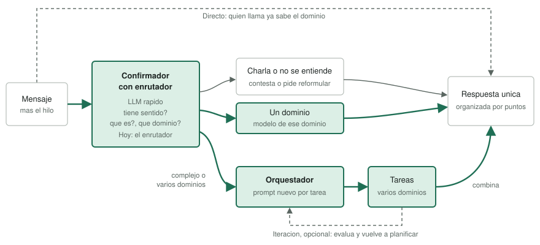
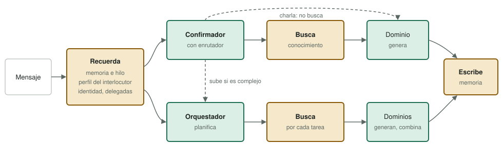

# El camino

Estado: mapas aprobados por el operador el 2026-11-04. Prioridades y nombres
definitivos, pendientes.

Una pagina con la idea central del ente. Lo que define el proyecto es el
orquestador: entiende el mensaje, crea un prompt por tarea, lo manda a los dominios
que correspondan y devuelve una respuesta unica organizada por puntos.

Cada hito indica que parte de estos mapas mueve. Si no mueve ninguna, hay que
justificarlo.

## Mapa del core

## Mapa con extended

El core entiende, reparte y genera. Extended recuerda, busca y escribe.

## Los modos

| Modo | Que hace | Orquestador | Itera | Dominio | Hoy |
|---|---|---|---|---|---|
| Directo | Contesta el modelo del dominio que indica quien llama | No | No | Lo fija quien llama | `directo` con dominio fijo |
| Confirmador con enrutador | Comprueba que el mensaje tiene sentido, lo clasifica y lo manda a un dominio | No | No | Lo elige el confirmador | `directo` con `domain: auto`: solo elige dominio |
| Orquestador | Crea tareas y combina sus resultados | Si | No | Uno por tarea | `task.run` con esfuerzo bajo, fuera de los menus |
| Orquestador con iteracion | Lo mismo, y evalua y vuelve a planificar | Si | Si | Uno por tarea | `iterativo` (`task.run`), prototipo |

Los nombres de la columna "Hoy" son los del codigo y no cambian por esta pagina.
`razonado` (`reasoning.*`) queda fuera de los mapas: un solo modelo critica su propio
borrador. Se decidira si sigue.

## El confirmador con enrutador

Es el enrutador del core con otra funcion, no una pieza nueva. Sus salidas son: no
se entiende (pide reformular), charla (contesta sin buscar), un dominio, o complejo
(sube al orquestador).

Una respuesta de charla rara es un rasgo de personalidad, no un error de
conocimiento. Lo que no se admite es una pregunta real clasificada como charla: ante
la duda, a un dominio.

## Lo que falta

- Confirmador: salidas de charla y no se entiende, ver el hilo, escribir un prompt
  limpio y subir al orquestador. Recordar pasa a ir antes de clasificar; hoy, en
  directo, va despues.
- Orquestador: no inventar cuando no entiende, streaming con memoria y conocimiento
  (`edge CR-0003`), y un plan mas rapido.
- Menores: perfil comprobado de punta a punta en cada modo que se les abra.
